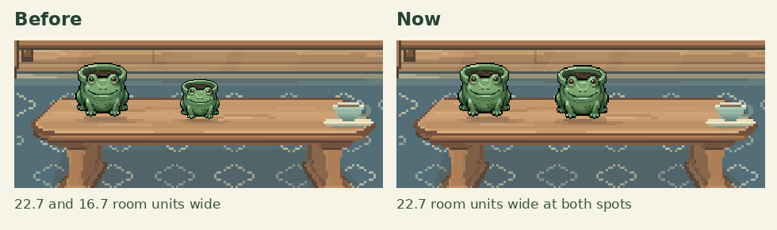

# Interface and art

## Launch and first play

The browser link opens the four-card welcome tour and installation instructions. Gameplay starts when the player opens the installed app. `usePhoneApp` reads the display mode. Accepting a browser install prompt leaves the current tab on the tour. [App entry](../../src/App.jsx) · [Install prompt](../../src/installPrompt.js) · [Welcome tour](../../src/WelcomeTour.jsx)

In an installed session, the saved setup phase selects the screen. A new player can name a seed or restore a garden. Eligible players can opt into alerts. Confirming the name creates the plant and starts its clock. The watering lesson uses the real **Heart → Care → Water** controls. The shared LeafReveal animation plays on the welcome card and immediately after a successful naming, with a reduced-motion bypass. Welcome card three uses the live room renderer. After watering, the player enters the room by swipe or button. Placing the starter pot advances the saved lesson to the return gesture. The return button and swipe save the 200-coin gift before opening the toy. Until the pot is placed, the garden guides the player to iSEED. Once the pot is placed, it guides them back to the seed. The toy guides four purchases through its regular Growth Spurt menu. The fourth purchase starts normal play. The sprout greeting shows the live water timer and Dew Catch. The final gift saves the reminder invitation with the reward. Deferring it saves the follow-up check-in chat until the player acknowledges it. [Reminder walkthrough](../../tests/browser/tutorial_reminders.py) Each iSEED app hint is remembered when first shown. First Aid explains treatment on the first outbreak. Plants without the tutorial record finish the older phone guide by opening Shop. Existing completed saves keep their normal entry point. A completed installation opens on the toy. A full reset replays the tour. [Setup and naming](../../src/PlantSetup.jsx) · [Screen transitions](../../src/OnboardingTransition.jsx) · [Save hook](../../src/useGardenSave.js)

The Plantigotchi companion app reads the same plant and clock as the keychain, including Growth Lab time. My plant measures full maturity against a week of earned growth and stage progress against the current milestone interval. The weekly scale has seven numbered days. The stage scale uses four-hour segments, with a proportional final segment for shorter intervals. The first hour uses four 15-minute segments. Only the full meter remains once the plant matures. Every collection card displays the full species name from the seed roster. Maturity reveals the portrait from active, waiting, graduated or mature Leaf Book records. Shop purchases do not count. Pot fit uses the soil contact while each collection silhouette centers its visible foliage bounds. The root-contact test compares the basal pixels on the three carnivorous plants and twenty additional species across all four pots and three poses. Locked cards display separate single-ink foliage masks. Regenerate them with `python scripts/render-seed-silhouettes.py` when species or mature art changes. The gradient and question marks drift together behind visible cards and stay still with reduced motion. The launcher uses six 240 × 240 SpriteCook tiles in Shop, Inventory, Journal, Care library, Postcard and Plantigotchi order. Vite fingerprints the [production atlas](../../src/art/iseed-launcher-hd.png) for installed-app updates. The [art record](../art-review/iseed-launcher-hd/spritecook-assets.json) identifies the reviewed artwork.

The iSEED shop opens a native close-up dialog for a catalog entry. It draws the same item art at 3×. Browsing works below the item price. Buy hands off to room placement, where the existing confirmation performs the coin transaction. Back or Escape restores the catalog selection.

During the first pot purchase, the guide and Buy button share a panel over the ceiling. Keep the panel independent of the room viewport so choosing a destination, wrapping a message or saving the pot cannot resize the camera. Short landscape screens use a single row of controls to keep the upper shelf targets reachable. A slow starter-pot save checks the saved pot and retries once with the same item ID. If storage stays busy, the **Retry save** button keeps the selected spot. Once the pot is saved, the garden guide offers **Return to my seed** alongside the usual return gesture.

## Social link preview

Sharing the public game link uses the static metadata in `index.html`. Its 1200 × 630 PNG pairs the current jade device and grown Monstera from the toy screen with the living room rendered at noon. The small growth sprites come from the welcome tour. Use the game’s Bricolage Grotesque, DM Sans and Silkscreen faces for the title, caption and series label. For a future artwork change, use a fresh public image URL, update both platform tags and describe the new artwork in both alt fields. The iSEED Postcard app makes a separate picture of the player’s own room. [Current card](../../public/social/pocket-garden.png) · [Metadata check](../../tests/socialPreview.test.js)

## Surfaces and navigation

| Surface | How players use it | Code to change |
| --- | --- | --- |
| Toy | Swipe up on the wallpaper or activate the bottom chevrons to enter the garden. The device and chain each handle their own touches. | [Passage gestures and focus](../../src/useHandsetPassage.js) · [Chevron control](../../src/SwipeCue.jsx) |
| Garden | Swipe horizontally to pan between rooms. An upward or downward swipe on open room space returns to the toy. Activate the lower-right iSEED to open the handset. | [Garden interactions](../../src/Collector.jsx) · [Room targets](../../src/RoomView.jsx) |
| iSEED | Home opens the launcher. Back steps through the current app. Putting down the handset returns to the room. Shop, Inventory, Journal, Care library and Postcard live here. | [Handset and launcher](../../src/ISeedPhone.jsx) · [App routing](../../src/GardenPhoneApps.jsx) |
| Global menu | The three waves open backgrounds, Settings, alerts and saves. Close returns to the surface that opened it. The notification test is under Debug, reached by holding both lower corners of Settings for five seconds. | [Global pages](../../src/App.jsx) · [Glass dialog](../../src/GardenDialog.jsx) · [Debug gesture](../../src/SettingsDebugGesture.jsx) |

The toy and garden share one viewport overlay for Plant Garden, Share, the waves menu, the purse and the local clock. Its buttons stay outside the moving scene layers. Empty overlay space passes touches through to the toy and room, and scene-specific swipe handles stay attached to their gesture layers. During placement or required lessons, keep the purse available and leave the controls clear. The garden’s iSEED launcher stays in its lower-right corner. About and Report a bug live under App & data. Both use the version in `package.json` so the displayed version and email subject agree. [Screen controls](../../src/App.jsx) · [Viewport and menu regression](../../tests/browser/garden_hud.py)

The root exposes `data-surface` and `data-transitioning`. Inactive surfaces stay inert and hidden from assistive technology. Preserve control, scroll and placement exclusions when changing swipe handling. Keep the iSEED app mounted while the handset is lowered so a Journal draft, its subject and scroll position survive. [Surface styles](../../src/pocketGarden.css) · [Journal sessions](../../src/journalDrafts.js)

## Toy controls and feedback

The LCD is display-only. Arrows browse one item at a time beneath the centered plant. Heart selects. Back returns one level or opens the pause menu during a game. Holding Back exits to the plant. Keyboard input uses left/right arrows, Enter or Space for Heart, and Escape or Backspace for Back. Accepted presses immediately play their wooden click or care sound. Each fresh chat prompt has its own bell. Preserve normal activation when a real button has focus. [Toy input and navigation](../../src/PocketDevice.jsx)

For a care option, change the available cards in `GardenLife.jsx` and the rule in `game.js` that rechecks the action against the current plant. Readouts use `plantReadout.js`. Growth, mood and reactions are drawn by `PlantPixel.jsx`. Minigame rules and timers live in `pocketPlay.js`, with LCD graphics in `ActivityArt.jsx`. The game pauses when the toy loses focus to another surface or menu. [Menu cards](../../src/GardenLife.jsx) · [Readouts](../../src/plantReadout.js) · [Plant sprites](../../src/PlantPixel.jsx) · [Minigames](../../src/pocketPlay.js)

The Golden Pothos on the toy is drawn on the LCD’s 72 × 40 grid. Each stage defines a vine from the soil to a set of leaf attachment points. Idle movement flexes the blade below its attachment. During a wilt, the vine and its attachment points lower together. Check all five stages on the device, especially the mature runner beside the pot and the leaf lift after watering. [Pothos shapes and stage layouts](../../src/pothosArt.js) · [LCD renderer](../../src/PlantPixel.jsx)

The Snake Plant uses folded, gold-edged blade patterns on the same grid. Each growth stage has its own blade lengths and spacing. The two breathing seed frames and three foliage poses share a soil anchor with the wilt and recovery frames. [Blade patterns and growth stages](../../src/snakePlantArt.js)

Hoya Splash uses paired round leaves, silver markings and a fine trailing runner. The blade motion and wilt are shared with Pothos. Each species owns its leaf shapes and stem layout. [Hoya growth stages](../../src/hoyaArt.js) · [Vine animation poses](../../src/vineBlade.js)

The Monkey Tail Cactus grows from an upright shoot into rounded hanging stems. Its pale hairs follow the curve of each stem. The mature flower attaches to the same point in each sway pose. During a gnat outbreak, the silver spines keep their color. Swarming gnats, fungus on the soil and a progressively lower posture show the infestation. Drought draws in the stems and reduces their thickness while the pot stays fixed. [Cactus shapes and poses](../../src/monkeyTailArt.js)

Queen Anthurium grows longer pendant blades on separate petioles. Its light midrib and side veins follow the blade during sway, wilt and watering. During a gnat outbreak the velvet green and silver markings persist as the plant droops. [Queen Anthurium stages](../../src/queenAnthuriumArt.js)

Pink Micans has heart-shaped velvet leaves with blush sectors and copper-colored folds. Its long runner passes below the pot rim. The pink patches stay visible through gnat outbreaks and become muted through the two thirsty poses. [Pink Micans stages](../../src/pinkMicansArt.js)


`useGardenTilt` maps device orientation to screen-relative gravity. `chainMotion.js` handles the chain and ring, including drag and release. `GardenSound.js` owns the effects audio context, retries activation on user input, and observes sound settings and page visibility. Add synthesized effects in `gardenVoices.js`. The purchased record player has a separate media lifecycle. [Tilt](../../src/useGardenTilt.js) · [Chain physics](../../src/chainMotion.js) · [Sound](../../src/GardenSound.js) · [Record player](../../src/GardenRecord.jsx)

The two 128 kbps MP3s live in `public/music`. One player spans the public tour, installed setup and all three gameplay surfaces. Both tracks peak at 50% gain. Cotton Candy Skies loops through the optional practice round. Start its five-second fade from the farewell chat’s actual reveal, so claiming the gift immediately lets the fade finish. A first visit waits for the settled garden transition before fading Mystic Oasis up to that level in 750 ms. A later visit with completed onboarding starts Mystic on entry. The three Settings sliders mix the score and record player (Music), triggered voices (Sound effects), and the garden breeze and sleeping seed (Garden ambience). The percentage multiplies each channel’s established mix. Moving a slider previews its level immediately while edits settle into a save transaction. Preserve other channels when windows edit concurrently. A legacy master mute starts all three at zero. A legacy ambience mute starts Music and Garden ambience at zero. Selecting a garden record temporarily gives that record the music channel. Browsers that require user activation start the selected track on the first tap or keypress. [Scene selection](../../src/GameMusic.jsx) · [Playback and fades](../../src/scorePlayback.js) · [Browser walkthrough](../../tests/browser/scene_music.py) · [Mixer and migration checks](../../tests/browser/audio_mixer.py)

## Garden placement and rendering

For shop portraits, placed sizes, shelf clearance and foreground-to-background depth, see the [illustrated pot and plant scale audit](research/garden-scale-audit.md).

### Placement depth and shop size

A movable item keeps its authored proportions. Its supporting surface determines apparent size. Every pot, plant, frame, record player and Maneki-neko on a given piece of furniture uses the same multiplier. The original comparison images and measurements document version 0.1.17. The following fixed-camera crops show the two Bog Frog Pots before and after the surface rule.



| Support | Scale applied to room art |
| --- | ---: |
| Wall shelves, cabinet and bookcase top | 0.72× |
| Both windowsills, including the decorative frame spots | 0.80× |
| Drawing desk | 0.86× |
| Coffee table | 0.94× |
| Freestanding display tables | 1.00× |
| Floor | 0.91× to 1.12× by projected contact point |

Add plant and pot addresses to the room layout. Keep saved numeric and named addresses stable. For a decorative spot, select its supporting surface from the same scale table. For floor art and hit targets use the places projected with the current extra floor height; portrait can reverse the depth order of the two front spots. Paint farther floor objects first. A carried plant takes the destination’s scale over a valid spot and its source scale between destinations. Postcards use their own wide room projection. [Placement geometry](../../src/gardenLayout.js) · [Decor and frame geometry](../../src/roomShopArt.js)

Shop portraits retain individual framing for readability. **Compare garden sizes** draws every catalog item beside the same terracotta pot at windowsill scale. Use the real room renderer for comparison so nursery proportions, pot and foliage stay together. Review a new SKU in its portrait, comparison view, actual placement preview and saved room. For tall or trailing plants check shelf clearance in every pot and inspect the postcard. Shelf boards can obscure tall leaves. Open tables and desks allow foliage to rise above their surface. [Geometry tests](../../tests/gardenScale.test.js) · [Shop comparison walkthrough](../../tests/browser/shop_scale.py) · [Garden walkthrough](../../tests/browser/garden_resolution.py)

The garden rests 8% closer than the original wide view. A stationary press on open scenery uses the same temporary 1.32× focus as a scene tap. Swiping still changes surfaces or pans across rooms. Keep a visible room’s backing canvas at the same resolution throughout a gesture. Resizing it clears its pixels, including while input belongs to the handset or the toy. The visible room keeps its animation clock while iSEED is raised or moving, including during a held or cancelled swipe. Garden input stays with the active surface. The room animation timer pauses when the document is hidden or reduced motion is requested. [Touch transition regression](../../tests/browser/garden_passage.py)

Tapping a room asset frames the live artwork in the garden camera. The item's name and location sit above it. Actions and explanatory text share a scrollable area below the artwork. Keep instructions in document flow there. The Done button has its own footer. When a resident shares a spot with a purchased pot, either tap target opens the same three choices. Begin with no selection and show actions only after the player chooses Plant only, Pot only or Plant + pot. A soft radial vignette follows the selected asset in both lighting modes. Its clear center keeps the artwork visible while its outer shading supports the lettering. Frame the entire plant when foliage and pot have separate hit targets. Show the sprite in its ordinary colors during inspection. Use the outline and shine for room navigation outside the close-up. Keep original frame photos and room layers in the same lens. A scenery tap holds focus for five seconds, then eases back over 2.2 seconds. Asset inspection waits for the player to act or dismiss it. Reduced motion makes inspection instantaneous. [Inspection view](../../src/GardenInspection.jsx) · [Day and night walkthrough](../../tests/browser/garden_inspection.py)

The room uses Canvas 2D in a 400 × 320 logical space. Portrait extends the ceiling and floor. `RoomView` uses the same vertical offset for pixels, framed photos and DOM hit targets. `roomArt.js` draws plants at their pot baselines in the order supplied by the scenery. Floor plants can overlap a framed photo through a separate foreground canvas. Keep those layers inside the same camera transform so pan and zoom agree. [Room layout](../../src/gardenLayout.js) · [Paint order](../../src/roomArt.js) · [Scenery](../../src/roomScenery.js) · [Photo layers](../../src/FramePhoto.jsx) · [Garden sprite resolution and verification](research/garden-item-resolution.md)

On launch, measure the viewport before painting the garden. The layout effects paint the room and floor once at their final dimensions before the browser presents them. Starting the animation timer should not trigger another immediate paint. Returning to a visible tab or changing the reduced-motion setting does refresh the room. The resolution walkthrough also counts first-frame paints at two phone densities. [Launch regression](../../tests/browser/garden_resolution.py)

While dragging between the toy and the room, write the toy visibility only to the layers that change. On release the browser interpolates opacity, blur, scale and handset position. The room continues painting at its measured resolution, including behind iSEED. Changing input ownership alone should not redraw a populated room. [Surface transitions](../../src/useHandsetPassage.js) · [Swipe walkthrough](../../tests/browser/garden_passage.py)


Slot addresses are saved data. Each room retains its six numbered plant spots. Later surfaces have named addresses and decorations have their own slots. For a new spot, update its visual anchor, legal destinations and hit target together. For a shop item, follow `catalog`, `canSetItem` and `placeItem`. Placement circles carry a soft radial pulse inside their existing rim. The center dot or swap arrows stay steady, and reduced motion keeps the marker still. Selecting a circle previews a destination. Confirmation rechecks its occupant and commits the placement and any purchase charge together. Test canceling before confirmation and moving into an occupied spot. [Economy and placements](../../src/gardenEconomy.js) · [Shop](../../src/GardenShop.jsx) · [Garden controller](../../src/Collector.jsx)

Keep the full-color master when adding a plant, pot or decoration. Register its crop in the [native art builder](../../scripts/build-native-garden-art.py) and check the garden close-up at the phone’s display density. Garden plants and shop tiles share `drawPottedPlant` through `roomShopArt.js`. Check the actual shelf and shop tile at native scale, along with night lighting, selection and reduced motion. Personal framed photos use an original-resolution image inside the pixel-art aperture. Use the existing review workflow when changing a sprite. [Plant renderer](../../src/roomPlant.js) · [Shop renderer](../../src/roomShopArt.js) · [Sprite review workflow](../../.agents/skills/plantigochi-sprite-review/SKILL.md)

### Pot and plant composition

Every garden plant uses one four-layer composite at the pot foot. This applies to nursery specimens, shop plants, graduates, placement previews and postcards.

| Order, back to front | Contents | Motion |
| --- | --- | --- |
| 1. Back half of pot | Rear lip, inner wall, soil and contact shadow | Fixed to the surface |
| 2. Rooted stalks | Lower neck, stems and petioles entering the soil | Base pinned, upper stalks sway |
| 3. Front half of pot | Front lip, body, painted face, raised eyes or handles that face the viewer | Fixed to the same pot anchor |
| 4. Leaves and crown | All blades, flowers and hanging foliage, on either side of the stem | Follow their attachments through the sway cycle |

**Authoring a pot.** Supply a complete empty vessel. Trace the inner front boundary in its native pixels, including raised details. Define the soil attachment point and clearance a plant needs above the rim. Approve the pot empty first so gaps hidden by a plant are visible. Keep its proportions and ground contact when a plant is added.

The garden renderer derives a short contact shadow from the lowest four native rows of the empty vessel, before adding stalks and leaves. Keep the actual foot shape visible in the source, including gaps between feet. The shadow uses the existing pot cache and softens at night. Shop portraits omit it. The garden size comparison uses the same surface shadow as a placed pot.

**Authoring a plant.** Capture the crown and rooted stalks separately from any pottery. Record the stem attachment in source pixels and mark the rooted-stalk region. Assign the growth habit before mounting. For a basal succulent or rosette, record the living origin where its shoots meet. Align that exact pixel to the soil center in both X and Y in every pot and pin it through every pose. Monkey Tail Cactus and Snake Plant use this mount directly. For a stalked plant, give the lower stem enough length to reach the soil in a tall vessel. Center the plant over the opening. Use the center of the soil opening for every rooted attachment, including off-center sockets in the master art. The Bog Frog Pot has a shallow seat between its eyes. Golden Pothos and Hoya Splash root at that seat and trail over the rim without a manufactured upright stem. Queen Anthurium has a visible short neck and pendant leaves. For room scale, encode the mature plant from its full SpriteCook master and size its canopy separately from the shop portrait. Prayer Plant stays low and full. Basal plants follow the soil center even in a decorative vessel. Monkey Tail Cactus and Queen Anthurium keep their centered drape. Let individual leaves cross the front decoration where the species naturally hangs. Review left, neutral and right poses at the same baseline, with reduced motion showing the neutral composite.

**Placement and persistence.** Vacant shelves start clear and accept a plant or an owned pot. Every resident on its own displays the approved Terracotta pot. Use the separate mounted foliage for nursery portraits and garden placements, including older shop plants. An owned pot at the slot supplies its own artwork and soil anchor. Older saves can contain a decorative `potStyle` number, which the renderer ignores. The room looks up the plant and pot separately at a saved slot. Plant only leaves a purchased pot at the source. Pot only leaves the resident at that address. Moving the pair takes both identities. A purchased source pot displaces a destination pot into inventory on a pair move. Swapping two placed pots exchanges their addresses while each resident keeps its own address. Dropping on a different support recalculates physical scale from that surface. Between destinations a plant-only drag shows the plant by itself. Over a valid target the garden shows the complete destination composite. Cancel, reload and restore must resolve from saved item and plant identities.

**Review before release.** Compare each new plant in the nursery pot and every swappable pot. For a new pot, reverse that matrix across all species. Inspect the room at shelf size, a close-up, the shop tile, the carried preview and postcard. Exercise plant only, pot only, a pair move, swapping occupied pots and reloading after placement. The source masters and the shared painter are versioned together. [Plant renderer](../../src/roomPlant.js) · [Full-resolution review matrix](../../.agents/skills/plantigochi-sprite-review/references/seed-collection/plant-and-pot-review-v3.png) · [Rebuild the matrix with the live renderer](../../.agents/skills/plantigochi-sprite-review/references/seed-collection/render-pot-review.py) · [Animation keyframes](../../.agents/skills/plantigochi-sprite-review/references/seed-collection/frog-sway-v2.png) · [Pixel tests](../../tests/plantLayering.test.js) · [Day and night move walkthrough](../../tests/browser/garden_inspection.py)


When adding a shop plant, give it a stable SKU in the catalog and a tile baseline in `shopPreviewLayout.js`. Route the SKU through `drawShopPreview` and `drawPottedPlant`, then check any allowed-species and display-name lists used for residents and saved gardens. Buy it, put it on a shelf, move it, and reload a backup. A redesign of an existing plant can keep its SKU and use the same placement and save paths. [Shop preview layout](../../src/shopPreviewLayout.js) · [Shop painter](../../src/roomShopArt.js) · [Plant painter](../../src/roomPlant.js)

Bird of Paradise opens its orange-and-blue flower above a fan of paddle leaves. Moth Orchid opens pink flowers along an arch above its basal leaves. Both use hand-authored keychain growth and wilt frames. Their mature room foliage uses SpriteCook masters anchored at the crown so pottery can change. [Keychain stages](../../src/floweringPlantArt.js) · [Garden masters and rebuild script](../../.agents/skills/plantigochi-sprite-review/references/launch-flowering-plants)

Launch shop plants include Monstera Albo, Pink Micans, Hoya serpens “Splash”, Queen Anthurium, Monkey Tail Cactus, Bird of Paradise (600 coins) and Moth Orchid (700 coins). The two wild pots are Bog Frog Pot and Lava Pop Pot. The SpriteCook refresh also replaces the artwork for the eight earlier products using their existing save IDs. The plant painter composites indexed sprites with the shared pottery, light, selection and idle poses. For trailing plants the painted foliage can extend below a shelf or table's pot line. The two frames share the same new image openings across room, shop and postcard views. [First launch masters](../../.agents/skills/plantigochi-sprite-review/references/phase-1-shop-pass-01/README.md) · [Approved shop refresh and encoder](../../.agents/skills/plantigochi-sprite-review/references/phase-1-shop-pass-02/README.md)

## Verification

From the repository root, run the group that covers the change.

```sh
node --test tests/installPrompt.test.js tests/alertInvitation.test.js tests/journalDrafts.test.js
node --test tests/chainMotion.test.js tests/screenGravity.test.js
node --test tests/collector.test.js tests/gardenEconomy.test.js tests/roomFrameArt.test.js
```

For an input change, play through first watering, start a minigame and hold Back, then open iSEED, type a Journal draft, put down the handset and resume it. Try touch and keyboard with reduced motion enabled. For a placement change, preview and cancel a purchase, buy it, move it directly from the room, and reopen the garden to verify its saved location.

### Garden furnishings review after v52

Storage furniture, the cutting jar, the Leaf Book, and the garden details apart from the cup and saucer have art approval. The update includes a front-facing calico kitten, a centered cup and saucer, a mirrored Garden Coin and exterior camera movement. The kitten has separate awake, resting and blink expressions. The lacquer photo frame remains deferred.

The coin generator mirrors each eight-pixel half-row across the center. The cup rim, foot and saucer share a horizontal center, with the open handle attached on the right. The living room owns the mountain silhouette. The studio window faces the village pagoda. During horizontal garden scrolling, the exterior terrain shifts by up to eight native pixels within each clipped window. Furnishings, hit targets, and indoor floor lines stay attached to the room. Reduced motion fixes the outdoor offset at zero.

The sofa calico's rounded tail tip, continuous curl and connected front legs were approved on November 22, 2026. The approved poses are awake, shoulders raised and resting. The v53 pose on the board is the live comparison. [Figma approval](https://www.figma.com/design/JnUvdBVJl2ymB7sCpibZQ0/?node-id=9-2)

The toy and garden share one passive purse display backed by the saved Garden Coin balance. The iSEED wallet uses that same balance. Sprouting sets a reveal marker on the plant. The first visible toy view consumes it and briefly lights the case with feathered rays and stars. Reduced motion shows a still glow. Reloading an already viewed sprout does not restart the burst.

Keep the first visit on one round trip from toy to garden and back. The chat changes in place after watering so the first visible tap on **Visit my garden** goes to the button. Restrict full-page setup transitions to changes of screen. During a slow save, the garden button shows progress and offers a retry if the write times out. The player chooses a pot location before paying and can drag the room to reveal other spots. Hide the global menu and share controls during the required lessons. On the first visit to Dew Catch, explain the arrow controls and the three-miss rule before play starts. The tutorial invitation starts a single practice round. Finishing it or choosing **Maybe later** opens a short farewell on the toy. It pairs a thank-you with one line for the outcome and keeps **Claim 20 coins** inside the bubble, below the text. After collecting the gift the player can launch normal Dew Catch from the Play menu. Every visible tutorial popup uses the same cached bell sample at the same gain across the toy, garden and iSEED. Let the button play its own sound at activation. GuideChat reserves space for 250 ms after its cue becomes active, then shows the message, plays its bell and focuses any requested action. Changing cues or leaving the scene cancels the pending reveal. Give each new instruction a stable cue so background renders, balance updates and the repeating visual bounce stay quiet. The first-visit browser test compares the audio waveform across guided presses.

To replay the first visit on a local dev server, run `python tests/browser/first_visit.py http://localhost:5173` with Playwright for Python and Chromium installed. It uses a fresh mobile browser profile and holds a real database transaction open while returning from the pot purchase. The test checks that the garden stays visible until the gift saves, then spends the gift and returns to free play.

Run `python tests/browser/dew_lesson.py http://localhost:5173` to play the optional practice round through a win and a three-miss finish. It checks reopening a round, collecting the farewell gift once and returning to the normal game from the Play menu.

Run `python tests/browser/pot_purchase.py http://localhost:5173` to test buying the center windowsill pot while storage is busy or the purchase confirmation is delayed. The same test accepts a downloaded playtest HTML file and checks the saved placement and wallet independently of the on-screen receipt.

## Garden-first iSEED playtest

The garden owns room panning and placement. Its lower-right phone button raises iSEED to the playable leaf keychain. Both the toy and the six-app tray use the same handset. Keep the chevrons tappable and keyboard accessible. Reserve app content for scrolling, and toy keys and the chain for play. Stats opens the existing growth dashboard. The attention badge derives from the saved plant and current care clock and works without push permission.

Resume tutorial checkpoints from the phone. Placement still takes place in the room. The pot receipt returns the player to the toy for the growth lesson. Test from a new garden and an existing save.
