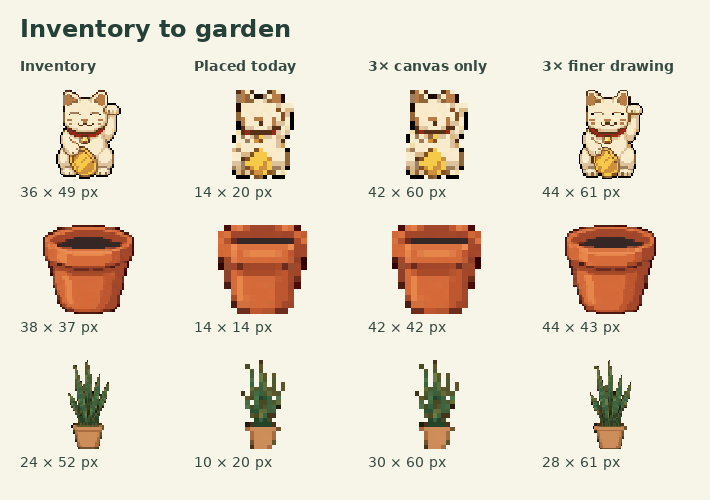

# Garden item resolution study

The v68 garden used a 400-unit-wide room with a 320-unit interior. Its backing canvases extend vertically for portrait. At a 393 × 710 CSS-pixel viewport, the room measured 400 × 723 backing pixels. Each of the two initial rooms mounted a depth and actor canvas. A foreground canvas also appears when an original framed photo needs objects in front of it. Inventory tiles render into 72 × 64 canvases and detail views into 144 × 128. The toy has a scalable interface and a 72 × 40 SVG plant coordinate system. These dimensions describe different parts of the screen. [Room layout](../../../src/Collector.jsx) · [Room layers](../../../src/RoomView.jsx) · [Inventory](../../../src/GardenShop.jsx) · [Toy art](../../../src/PlantPixel.jsx)

## What gets lost in placement

The pot and plant renderer divides size by sprite density, then rounds both ends of each horizontal color run to integer room coordinates. Many authored pixels become less than one room pixel on a shelf. Decorative objects have a similar rounding step. At a placement scale of 0.78 a double-density pot samples each source pixel at only 0.39 room pixels. The same pot’s inventory tile samples it at one tile pixel per source pixel. [Plant and pot renderer](../../../src/roomPlant.js) · [Decor renderer](../../../src/roomShopArt.js) · [Shelf scales](../../../src/gardenLayout.js) · [Preview scales](../../../src/shopPreviewLayout.js)

The table gives measured bounding boxes of opaque pixels in Chromium. It uses daylight, the normal inventory thumbnail, the upper living-room shelf for the pot and plant, and the nearby bookcase decor spot for the cat. The experimental column uses the same art and shelf positions, three samples per room unit, and rounding to the nearest third of a unit at the final draw step. The image enlarges the crops for inspection. Individual shelves, poses and plants have different dimensions.

| Item | Inventory | Garden in v68 | Canvas enlarged 3× | Finer drawing at 3× |
| --- | --- | --- | --- | --- |
| Maneki-neko | 36 × 49 | 14 × 20 | 42 × 60 | 44 × 61 |
| Terracotta pot | 38 × 37 | 14 × 14 | 42 × 42 | 44 × 43 |
| Snake plant | 24 × 52 | 10 × 20 | 30 × 60 | 28 × 61 |

All three canvas-only crops matched a nearest-neighbor enlargement of the current crop byte for byte. The finer drawing recovered the cat’s face, pot rim and leaf stripes from the existing artwork. The v68 postcard rendered at 1200 × 960 and shares the same coordinate rounding.

## Implementation and verification

Version 0.1.9 applies the finer drawing in the last column. The visible room chooses one to three backing pixels per logical unit from display density, room width and focus zoom. Each detailed layer is capped at four million pixels and 4096 pixels high when selecting the scale. Depth, offscreen rooms, and the blurred toy backdrop stay on the original grid. Sprite runs, contours, carried plants, previews, postcards and photo apertures share the final grid. Camera, saved slot addresses and tap targets retain logical coordinates.

A 393 × 710 viewport at 3× device density allocated 1200 × 2169 for the visible actor layer, about 9.9 MiB for one RGBA bitmap. Actual browser memory use includes other layers and caches. Chromium reproduced the three measured crops in the last column and exercised cross-room preview, placement and reload at both 1× and 3× device density. Performance on physical Android and iPhone devices remains to be checked. [Garden walkthrough](../../../tests/browser/garden_resolution.py)

## 0.1.34 · 3× pots and plants

The iSEED Shop and My Items previously drew normal portraits at 72 × 64. They now draw at 216 × 192, inventory detail at 432 × 384 and shop close-ups at 648 × 576. The earned collection tiles use the same renderer. The six reviewed SpriteCook pot masters supply the original glaze detail for both iSEED and the garden.

Garden plants and pots use small cached images drawn at three samples per native sprite pixel. Each image is cropped to the visible pose. Only visible ceramic receives the higher-detail glaze, so crossing leaves, stems and contact shadows keep their positions. Cached images share a three-megapixel budget. The visible room requests a 3× output grid within its canvas limits. Offscreen rooms and background layers retain the lower-cost rendering introduced in the earlier swipe fix. [Garden renderer](../../../src/gardenSpecimenStamp.js) · [iSEED portraits](../../../src/SpecimenPortrait.jsx)

## 0.1.36 · Use the original artwork at each display size

The game packs the approved artwork for 40 plant crowns, 10 pots and four decorations into one 768 × 857 transparent atlas. The starter Monstera uses its procedural leaf renderer. The build script preserves original colors, approved edits, and native pixel dimensions. Rebuild with `python scripts/build-native-garden-art.py` using Pillow, NumPy and SciPy. The PNG and region map are committed and included in offline installs. The renderer uses the existing indexed art during decoding. [Atlas builder](../../../scripts/build-native-garden-art.py) · [Original cutouts](../../../src/shopSprites/native-regions.json)

Use one fitted source for shop, inventory, earned portraits, carried plants, the room and postcards. Fit it to the existing socket and footprint. Root strips behind the pot lip stay hidden. The crown samples the same registered bitmap across its sway bands. Apply lighting once per source and lighting step. Render at a minimum of three backing samples per portrait layout unit and increase it when a larger on-screen portrait requires more device pixels.

| Original cutout | Native pixels |
| --- | --- |
| Thai Constellation | 80 × 95 |
| Prayer Plant | 95 × 78 |
| Queen Anthurium | 86 × 178 |
| Blue Willow Porcelain | 69 × 62 |
| Bog Frog Pot | 48 × 48 |

On a 393 × 710 CSS-pixel Chromium phone at 3× density, a focused windowsill previously stretched a 1,200-pixel canvas across 1,188 CSS pixels, providing about one sample per CSS pixel. After the camera settles the visible span uses 1,230 samples across 410 CSS pixels. Releasing focus restores the full room. This keeps a four-megapixel allocation limit per actor plane. Fine patterns below a display pixel blend on shelves. Close-ups can show detail up to the authored source. Check apparent sharpness and swipe performance on physical handsets.
