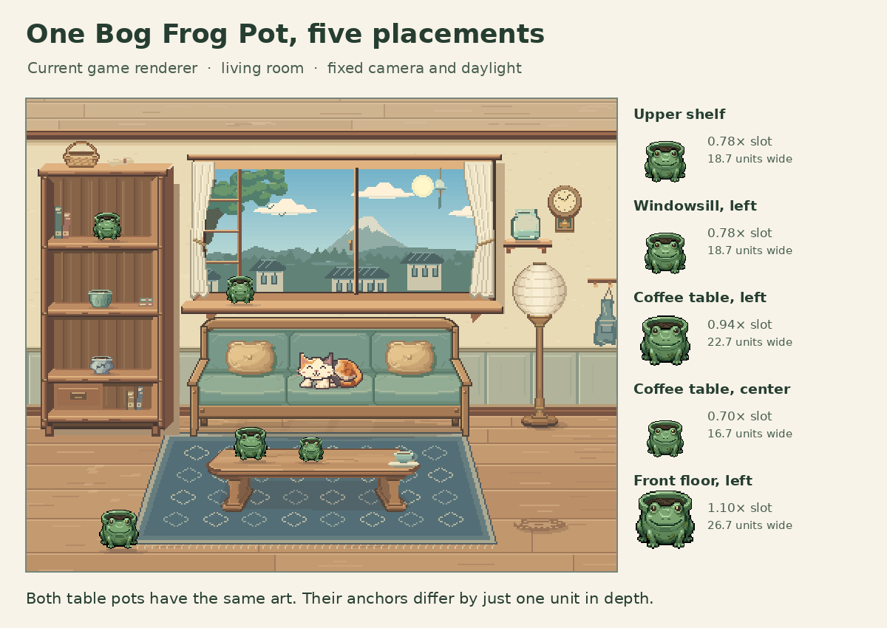
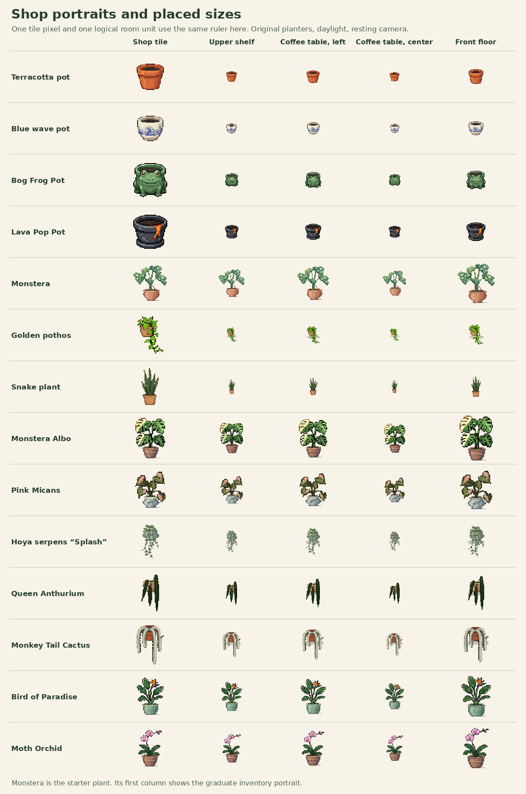

# Garden pot and plant scale audit

Measured against Plantigochi 0.1.17, revision `fdc188c`. The audit covers all four shop pots, all nine shop plant species, the growable starter Monstera, and all 24 plant-placement slots across the living room and studio. There are 1,296 placement combinations, including each plant in its original planter and each of the four replacement pots.

## What the screenshots show

The coffee table has two anchors just one logical pixel apart in depth. The original anchor draws a pot at 0.94× and the center anchor at 0.70×. Moving the same pot sideways can make its width shrink by 26% or grow by 34% on the reverse trip. The Bog Frog Pot measured 22.7 and 16.7 room units wide after pixel rounding. The center pot is even smaller than the frog on the left windowsill (18.7). In the second screenshot both frogs are in one frame, so camera zoom cannot explain their difference. Across screenshots the sofa and window also change apparent size, consistent with the separate 1.32× inspection camera.

## Depth across both rooms

| Surface | Living room today | Studio today | Suggested first tuning pass |
| --- | --- | --- | --- |
| Back-wall shelves and cabinet | 0.72–0.78× | 0.75–0.82× | Start around 0.80× on the back wall. Assign scale from where the furniture stands. Upper and lower shelves can share that depth. |
| Windowsill | 0.78× at left and center, 0.86× at right | 0.78× at left and center, 0.85× at right | Try 0.80× across each sill. All three living-room anchors share one baseline, as do the three studio anchors. |
| Coffee table or drawing desk | 0.94× original, 0.70× center | 0.86× original, 0.78× center | Try 0.94× across the coffee table and 0.86× across the desk. The coffee table reads closer to the player. |
| Floor near furniture | 0.91× by the shelf, 1.06× beside the sofa | 0.91× by the cabinet, 1.07× beside the easel | Use the floor contact point to interpolate through depth, starting near 0.91× and passing 1.06× by the sofa. |
| Front floor | 1.10× left, 1.12× right | 1.10× left, 1.12× right | Aim around 1.10× at the front, with the nearer spot at least as large as the farther one. Check both orientations. |

Portrait extends the floor. At a 393 × 710 viewport the left front-floor anchor in the living room lands about 37 room units nearer the bottom than the right one, yet draws slightly smaller. Its anchor takes 57% of the floor extension, versus 39% on the right. A floor depth rule should use the actual projected contact point. Applying that rule directly to a shelf’s screen height would make the upper shelf look much farther away than the lower shelf of the very same bookcase.

## Shop expectations and repotting

The shop list uses a 72 × 64 tile. Each SKU has its own preview magnification and baseline. The detail view doubles the canvas and art dimensions. Thumbnails communicate shape and detail, but give little indication of relative room size. For example, Snake plant, Moth Orchid and Bird of Paradise all measure 52 pixels tall in the shop. On the original coffee-table spot they measure about 24, 49 and 49 room units tall respectively. The Bog Frog and Lava Pop pots have equal 48 × 48 shop silhouettes and equal room footprints at each spot. Their authored size difference from the smaller terracotta and wave pots is consistent.

| Item | Shop tile ink (px) | Upper shelf | Coffee table, left | Coffee table, center | Front floor, left |
| --- | ---: | ---: | ---: | ---: | ---: |
| Terracotta pot | 38 × 37 | 15 × 14 | 18 × 17 | 13 × 13 | 21 × 20 |
| Blue wave pot | 37 × 36 | 14 × 14 | 17 × 17 | 13 × 13 | 20 × 20 |
| Bog Frog Pot | 48 × 48 | 19 × 19 | 23 × 23 | 17 × 17 | 27 × 26 |
| Lava Pop Pot | 48 × 48 | 19 × 19 | 23 × 23 | 17 × 17 | 27 × 26 |
| Monstera | 47 × 50 | 36 × 39 | 44 × 47 | 33 × 35 | 52 × 55 |
| Golden pothos | 38 × 53 | 15 × 21 | 18 × 25 | 13 × 18 | 21 × 29 |
| Snake plant | 24 × 52 | 9 × 20 | 11 × 24 | 9 × 18 | 13 × 29 |
| Monstera Albo | 42 × 57 | 33 × 43 | 40 × 54 | 30 × 40 | 47 × 63 |
| Pink Micans | 43 × 51 | 32 × 38 | 39 × 46 | 29 × 34 | 46 × 54 |
| Hoya serpens “Splash” | 25 × 48 | 16 × 31 | 19 × 37 | 15 × 28 | 23 × 44 |
| Queen Anthurium | 25 × 52 | 16 × 33 | 19 × 40 | 15 × 30 | 23 × 47 |
| Monkey Tail Cactus | 38 × 55 | 25 × 35 | 29 × 43 | 22 × 32 | 35 × 50 |
| Bird of Paradise | 38 × 52 | 29 × 40 | 36 × 49 | 27 × 36 | 42 × 57 |
| Moth Orchid | 33 × 52 | 26 × 40 | 32 × 49 | 24 × 36 | 37 × 57 |

Garden columns show visible width × height rounded to the nearest logical room unit. Original planters are used for species. Monstera’s thumbnail is the inventory preview for a graduate. It is outside the purchase catalog.

Three nursery plants (Hoya serpens “Splash”, Queen Anthurium and Monkey Tail Cactus) get a 1.65× room multiplier in their original pots. Switching to a shop pot selects separate repotted foliage and drops that multiplier. Final silhouettes depend on both pieces of art. For example, the cactus in its original pot and in the frog pot is about 43 units tall on the same coffee-table spot. The missing multiplier alone does not imply a 39% visual shrink. Check foliage width and root alignment alongside pot dimensions before altering this rule. A carried mature plant also uses a fixed 1.28× illustration while dragging. Its apparent size can change again on drop.

## Fit checks before changing scale

Surface clipping already cuts some tall plants. In the neutral pose, 80 of the 1,296 combinations lose opaque pixels to the slot’s clipping rectangle. The largest loss was about 19% for Monstera Albo in the Lava Pop Pot on the lower living-room shelf. Increasing the shelf scale to match the sill could worsen that cut. Check clearance above the pot and trailing leaves below the shelf lip at the proposed sizes.

1. First align anchors on the same table, desk and sill. Keep slot IDs and pot baselines so existing gardens retain their arrangement.
2. Tune background, middle and foreground depth with one frog pot and one orchid repeated in a fixed camera view. Keep genuine species and pot size differences. Check low shelves with the tallest and trailing species.
3. Keep the readable shop close-ups. For size comparison, show the selected item against one familiar reference, such as a standard terracotta pot on the same windowsill. Verify the placement preview and the saved result at the same camera zoom.

## Measurement method

Chromium used the production drawing functions with a fixed specimen ID per species, daylight, neutral pose and selection off. The shop used its real 72 × 64 tile and per-item framing. Isolated garden specimens used their actual slot scale, shelf or sill clipping and trailing allowance, at three backing pixels per logical room unit. Measurements count pixels with alpha of at least 128, excluding soft ground shadows. Clipping loss is the fraction of those pixels outside the slot’s clip before any furniture drawn in front. The illustration also uses the composite room renderer. CSS zoom, phone screenshot resolution, transient highlight and animation poses can change on-screen measurements.

[All measured combinations (CSV)](garden-scale-measurements.csv) · [Placement anchors](../../../src/gardenLayout.js) · [Room painter](../../../src/roomArt.js) · [Shop preview framing](../../../src/shopPreviewLayout.js) · [Plant and pot rendering](../../../src/roomPlant.js)
